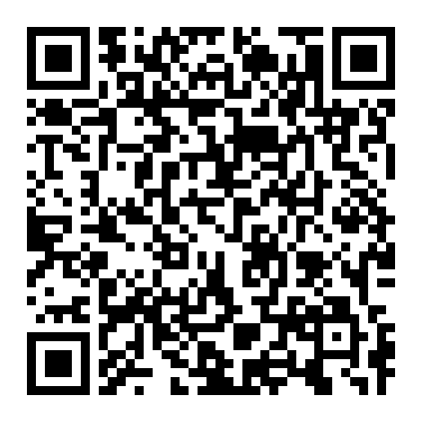

# Martin Ševčík

Been working in marketing for the past 10 years. Not a developer, which the code will confirm shortly.

[sevcikmarketing.com](https://sevcikmarketing.com) · [LinkedIn](https://cz.linkedin.com/in/sevcikmartin1) · [martin@sevcikmarketing.com](mailto:martin@sevcikmarketing.com)

**Čeština** | [English](#english)

## Co tu najdeš

Nástroje, které si stavím s Claudem, aby mi usnadnily práci. Co se mi osvědčí, dávám ven zdarma.
Zatím jsou tu dva pro práci s reklamou, časem přibudou i nástroje na jiné věci.

| Nástroj | Co dělá |
|---|---|
| [google-ads-mcp](https://github.com/martinsevcik1/google-ads-mcp) | Claude čte a spravuje Google Ads přes API: reporty, rozbor dotazů, negativa, vyhledávací i PMAX kampaně. Každý zápis až po tvém schválení. |
| [sklik-mcp](https://github.com/martinsevcik1/sklik-mcp) | Totéž pro Sklik: celé API Drak a k tomu Fénix (chytré kampaně, obrázky). |

> [!WARNING]
> Všechno tady je vibecoděné. Kód z velké části napsala AI podle mých zadání a já ho ladím při vlastní práci.
> Používám ho denně, ale počítej s chybami, neefektivním kódem i bezpečnostními riziky, na která jsem nepřišel.
> Když na něco narazíš, dej mi vědět přes issue u daného repa. Bezpečnostní problémy radši e-mailem.

### Pomohlo ti to?

Nástroje jsou zdarma. Pokud ti ušetřily čas a chceš mi to nějak vrátit, nejvíc mi pomůže recenze
na Google Mapách nebo na Firmy.cz. Stačí pár vět o tom, jak se ti s nimi pracuje.

<table>
  <tr>
    <td align="center"> <a href="https://search.google.com/local/writereview?placeid=ChIJ-XMER96VEkcRXoq1r8WHRhk"><b>Google</b></a></td>
    <td align="center"> <a href="https://www.firmy.cz/detail/13441299-mgr-martin-sevcik-sevcikmarketing-com-brno-stare-brno.html"><b>Firmy.cz</b></a></td>
  </tr>
</table>

## English

Tools I build with Claude to make my work easier. Whatever proves useful, I give away for free.
So far there are two for working with ads, tools for other things will follow.

| Tool | What it does |
|---|---|
| [google-ads-mcp](https://github.com/martinsevcik1/google-ads-mcp) | Claude reads and manages Google Ads through the API: reports, search terms, negatives, Search and PMAX campaigns. Nothing is written without your approval. |
| [sklik-mcp](https://github.com/martinsevcik1/sklik-mcp) | The same for Sklik, the Czech search ad platform: the whole Drak API plus Fénix (smart campaigns, images). |

> [!WARNING]
> Everything here is vibe-coded. Most of the code was written by AI from my instructions and I refine it in my
> own work. I use it every day, but expect bugs, inefficient code and security issues I haven't spotted.
> If you run into something, open an issue in the repo. Security issues by email, please.

If the tools saved you time and you'd like to give something back, a review on Google Maps or Firmy.cz (links
and QR codes above) helps me the most. Thanks!
